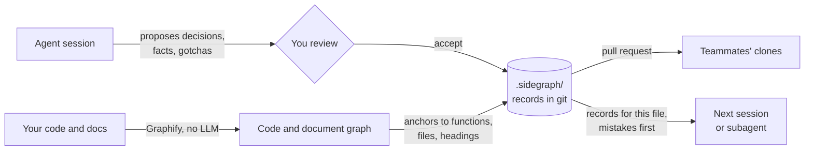

# Sidegraph

**Decision memory for coding agents.** Each session still starts fresh, but no longer as a
newcomer.

[](https://github.com/SantyagoSeaman/sidegraph/actions/workflows/ci.yml)
[](https://github.com/SantyagoSeaman/sidegraph/releases)
[](https://pypi.org/project/sidegraph/)


Works with **Claude Code** · **Codex** · **Grok Build** · **OpenCode** · **Muse** · any MCP client

Every project makes hundreds of choices while people talk to their coding agents and while
the agents reason through a task: an approach is accepted, an alternative is rejected, a limit
is discovered, a trap is paid for. Sidegraph turns that into **team memory**: the
**decisions**, the **facts** behind them and the **links between them**, **captured as part of
the work**, with no separate documentation step. **Any agent working on the project finds them
later**, weeks or years on, **at the code they concern**.

[Quickstart](#quickstart) · [Documentation](docs/README.md) · [Whitepaper](docs/whitepaper/index.md) · [Changelog](CHANGELOG.md)

## Why

**Engineers remember decisions, not code.** Code can always be reread. What an experienced
engineer carries is the chain behind it: which decision produced this function, which
constraint forced that decision, what was tried and abandoned. For decades teams kept that
chain in people.

**Agentic development removes the people who carried it.** Most decisions are now made inside
agent and subagent sessions that no human follows step by step, so nobody accumulates the
reasoning. The agents read the same code but **keep no decisions**: each session starts empty
and discards what it learned when it ends.

Two symptoms follow. **The project goes in circles**: a new session proposes the design an
earlier one already tried and abandoned, because nothing in the code says "we were here". And
**quiet breakage**: a change that is correct in its diff violates a constraint whose reason was
never recorded where the next agent would look.

## Already doing spec-driven development?

**Specs, plans, PRDs and ADRs record the intended change. The code records the result.** The
route between them runs through hundreds of smaller decisions: the constraint discovered during
implementation, the approach dropped after a failing benchmark, the reviewer who reversed an
earlier choice. Those shape the code as much as the plan does, and no template has room for
them. Writing an ADR for each would bury the team.

Sidegraph keeps exactly that route, and it **runs beside your workflow instead of replacing
it**. It was run beside five spec-driven workflows:
[Spec Kit](https://github.com/github/spec-kit), [OpenSpec](https://github.com/Fission-AI/OpenSpec),
[BMAD](https://github.com/bmad-code-org/BMAD-METHOD), [Superpowers](https://github.com/obra/superpowers)
and [genkovich-sdd](https://github.com/genkovich/sdd).

- **The two complement each other.** A Spec Kit plan imported into Sidegraph held only template
  text in its "rejected" field. The real fork of that change reached memory through the record
  the agent proposed at the end of the session.
- **Memory flows back into planning.** A later Spec Kit request was written so that its obvious
  solution was one an earlier record had rejected. Its specify and plan stages both retrieved
  that record before writing, and the design built on the earlier decision instead of
  reversing it.
- **Your existing documents become memory.** [Import](docs/getting-started/bootstrap.md) ADRs and
  specs from any of these workflows as records anchored to the code, and
  [export](docs/guides/adr-export.md) accepted decisions as Nygard or MADR ADRs into your workflow's folder.

## What makes it different

Three properties together, the combination an engineer's memory has:

1. **The memory belongs to the project.** Every record is plain JSON committed beside the
   code, **reviewed in pull requests like code** and **shared by every teammate and every
   session**. It is drafted by the session that did the work, not reconstructed later by
   someone who was not there.
2. **Every record is anchored to the code it governs**: a function, a file or a heading in a
   design document. From the code you reach its decisions, the constraints behind them and the
   **alternatives already rejected, with the reason**; from a decision you walk back through
   every version it replaced. **When code moves, the anchor follows it. When the code changes,
   the record is marked for review**, and when Sidegraph cannot tell where the code went, it
   says so instead of guessing.
3. **Memory is delivered at the point of work**: a map of the project when a session starts,
   and the records for a file, mistakes first, when the agent opens it. Records that sit in the
   repository with nothing announcing them go unread; Sidegraph's own measurements showed it.

Remove any one and what remains already exists: decisions without anchors are an ADR folder,
anchors without decisions are graph metadata, delivery without project ownership is session
memory. **Nothing is ever deleted**: a reversed decision is closed, not erased, so "we tried
that, and here is why it failed" stays findable.

## How it works



1. **Capture.** At the end of a session Claude Code, Codex and Grok Build remind the agent to
   propose what the session decided; any agent records a decision when you ask.
2. **Review.** You accept or drop each proposal. Until then it is stored as pending and shown
   to agents tagged `[unratified]`. Under the low-risk policy that setup offers, lessons,
   gotchas and facts anchored to code are accepted automatically while architecture decisions, constraints and
   domains wait for you. A decision or fact you ask for directly is accepted at once.
3. **Anchor.** [Graphify](https://github.com/Graphify-Labs/graphify) builds a graph of your code
   and documents without an LLM, and each record links to the functions, files or headings it
   is about.
4. **Recall.** The agent gets a file's records before it edits the file: on its own in Claude
   Code and Grok Build, on request in every agent, and, in Claude Code and Grok Build, in the brief of each subagent it starts
   ([limits](docs/guides/retrieval-in-sessions.md#memory-without-asking)).

Runs locally, no API keys. The graph and the index are rebuilt from your repository at any
time; the records are the source of truth.

## Quickstart

**Needs:** Git, [uv](https://docs.astral.sh/uv/) (it provides `uvx`; install it on
[macOS or Linux](https://docs.astral.sh/uv/getting-started/installation/#standalone-installer)
or [Windows](https://docs.astral.sh/uv/getting-started/installation/#winget)) and your agent.

**1. Install the plugin.** In Claude Code, in your repository:

```text
/plugin marketplace add SantyagoSeaman/sidegraph
/plugin install sidegraph@sidegraph
```

Other agents:
[Codex](docs/getting-started/installation.md#codex) ·
[Grok Build](docs/getting-started/installation.md#grok-build) ·
[Muse](docs/getting-started/installation.md#muse) ·
[OpenCode](docs/getting-started/installation.md#opencode-v2) ·
[any MCP client](docs/getting-started/installation.md#any-mcp-client).

**2. Set it up.** Start a new session and run `/sidegraph:setup` (in other agents, ask it
to set up Sidegraph). It installs the graph engine, builds the graph and creates the
`.sidegraph/` store, and asks you before it adds a git hook or accepts any records
automatically.

**3. Record something true.** Name a real file and function:

> Record this gotcha: the upstream API limits batch requests to 100 items. We rejected
> a single unbounded request because it fails for larger imports. Anchor it to
> `import_batch` in `src/importer.py`.

**4. Check it.** In a new session ask: "What should I know before I edit `src/importer.py`?"
The answer should include the gotcha and the rejected alternative. Then commit `.sidegraph/`,
`.gitignore`, and `.claude/settings.json` if the setup changed it. Each teammate installs the plugin and runs the
setup once after cloning.

[Upgrading](docs/getting-started/installation.md#upgrading-an-existing-install) ·
[Updating the plugin](docs/getting-started/installation.md#host-plugins-install-and-update) ·
[Setup from a terminal](docs/getting-started/quickstart.md) ·
[Troubleshooting](docs/getting-started/installation.md#if-something-does-not-work)

## Compared with what you already use

| You already have | What it keeps | What Sidegraph adds |
|---|---|---|
| Specs, plans, PRDs (Spec Kit, OpenSpec, BMAD) | The intended change, before it is built | What the implementation learned: rejected forks, constraints, later reversals, tied to the code |
| ADRs and design docs | The few choices worth a document | The hundreds of smaller ones, found from the code being edited; nothing has to point the agent at the ADR folder |
| `CLAUDE.md`, `AGENTS.md` | Guidance someone wrote down, loaded into every session | Records tied to the function they are about, delivered when the agent touches it, flagged when the code changes |
| Code search | What the code is now | What was tried and abandoned, and why, which the code no longer shows |
| Your agent's own memory | One developer's notes, in their home directory | Shared through the repository, reviewed like code, history kept |

## Where it pays off

Sidegraph pays off on a project with **a long history**, **frequent agent sessions**,
**authors who have moved on** and **constraints the code cannot explain**, where someone
reviews what the agent proposes to remember. The [pilot kit](docs/pilot-kit/README.md) checks
your repository before you install anything.

## What you can do

**14 skills · 25 MCP tools · 18 CLI commands · 5 agents · ADR folders and 5 spec-driven workflows**

| Ask for | What you get |
|---|---|
| `/sidegraph:explain-why` | Why this code is the way it is: the decision history, newest first, with what was tried and abandoned |
| `/sidegraph:check-plan` | A plan checked against memory before work starts: alternatives already rejected and why, constraints it must respect |
| `/sidegraph:import-adrs` | Your existing ADRs and specs turned into records anchored to the code |
| `/sidegraph:record-decision` | A decision, lesson, constraint or gotcha written down and anchored where it belongs |
| `/sidegraph:ratify-decisions` | The agent's pending proposals, one by one, with a recommendation for each |
| `/sidegraph:name-domains` | The code graph turned into named areas: a table of contents every session starts from |
| `/sidegraph:triage-drift` | Records whose code changed, checked: still true, or replaced with a new decision |

In Claude Code these are slash commands; in other agents, ask for the task in words.

<details>
<summary><strong>All 14 skills</strong></summary>

| Skill | Purpose |
|---|---|
| `setup` | Install the graph engine, build the graph, create the store, check the wiring |
| `explain-why` | The decision history behind a piece of code, including superseded records |
| `check-plan` | A plan checked against rejected alternatives, constraints and known gotchas |
| `record-decision` | Write a decision, lesson, constraint or gotcha with its anchors |
| `record-fact` | Write a benchmark, limit or observed finding, alone or as evidence for a decision |
| `ratify-decisions` | Review pending decisions, facts and domains |
| `import-adrs` | Seed memory from existing ADRs and specs, preview first |
| `name-domains` | Name the project's areas from the graph's communities |
| `manage-domains` | Add, split, rename or drop a domain |
| `triage-drift` | Confirm or supersede records whose code changed |
| `heal-anchors` | Repair anchors after a refactor or a graph rebuild |
| `health-check` | Diagnose the installation, the wiring, the store and the graph |
| `stats` | How often memory was asked for, and how much of the code carries it |
| `compact` | Pack the store's files into shards, dry run first |

</details>

<details>
<summary><strong>All 25 MCP tools</strong></summary>

| Tool | Purpose |
|---|---|
| `get_task_context` | Records and structure for the files you are working on, mistakes first |
| `query_decisions` | The decision half of `get_task_context` alone |
| `query_structure` | The structural-map half of `get_task_context` alone |
| `get_entity_history` | Every decision and fact anchored to one function or file, newest first |
| `find_entity` | Look up a function, class or file by name |
| `drill_down` | One domain: its purpose, subdomains and records |
| `list_domains` | Every domain, in every status |
| `list_domain_candidates` | Domain candidates computed from the code graph |
| `retrieve_decisions` | List decisions |
| `list_facts` | List facts |
| `list_proposed` | Decisions, facts and domains waiting for review |
| `add_decision` | Record a decision, accepted at once |
| `add_fact` | Record a fact, accepted at once |
| `add_domain` | Define a domain by hand |
| `propose_decisions` | Draft decisions and facts from the session for review |
| `propose_domains` | Draft domains for review |
| `ratify` | Accept or drop pending proposals |
| `ratify_decisions` | Deprecated alias of `ratify`, kept for existing callers |
| `supersede_decision` | Reverse a decision: close it and add its replacement |
| `supersede_fact` | Correct a fact the same way |
| `supersede_domain` | Rename or re-scope a domain |
| `add_anchors` | Anchor an existing record to more code |
| `record_drift_check` | Confirm a record still holds after its code changed |
| `sync_anchors` | Re-anchor the store against the current graph and report what moved |
| `verify_store` | Check the store's files against its write rules |

[MCP reference](docs/reference/mcp-tools.md)

</details>

<details>
<summary><strong>All 18 CLI commands</strong></summary>

| Command | Purpose |
|---|---|
| `sidegraph-mcp` | The MCP server, over stdio |
| `sidegraph-init` | Create the store and set up the graph hook and review policy |
| `sidegraph-bootstrap` | Import ADRs and specs from a supported workflow, preview first |
| `sidegraph-import` | Import rationale from the code graph and documents |
| `sidegraph-ratify` | Review pending proposals from a terminal or CI |
| `sidegraph-sync` | Re-anchor records after the graph changes |
| `sidegraph-domains` | Bootstrap, add and snapshot domains |
| `sidegraph-verify` | Check the store's integrity, for CI |
| `sidegraph-doctor` | Diagnose the store, the graph and the wiring |
| `sidegraph-stats` | Local usage report |
| `sidegraph-viz` | An offline, interactive graph of the store |
| `sidegraph-blame` | `git blame` joined to the decisions each commit carries |
| `sidegraph-export-adr` | Export accepted decisions as ADRs in your workflow's format |
| `sidegraph-export-okf` | Export the store as an Open Knowledge Format bundle |
| `sidegraph-prepare-commit-msg` | A git hook that suggests decision trailers for the commit message |
| `sidegraph-compact` | Pack the store's files into shards |
| `sidegraph-migrate` | Convert a store to the packed format |
| `sidegraph-require` | Raise the minimum Sidegraph version a store requires |

[CLI reference](docs/reference/cli.md)

</details>

## Trust & privacy

- **Local.** Sidegraph makes no network calls of its own and sends nothing anywhere; your
  agent sends what Sidegraph returns to its model provider, like any other context. See
  [SECURITY.md](SECURITY.md).
- **Reviewed.** Known secret patterns are redacted before storage (best effort). Agent
  proposals wait for your review unless you turn on an auto-accept
  [policy](docs/guides/capturing-decisions.md); decisions and facts you ask for or import directly
  are accepted at once.
- **Counted locally.** Usage counts for `sidegraph-stats` stay in a git-ignored local index;
  `SIDEGRAPH_TELEMETRY=off` stops them.

## Status

Sidegraph is in beta: tool names and formats may change before 1.0 (see the
[stability policy](docs/reference/stability.md)). Every release is on
[GitHub](https://github.com/SantyagoSeaman/sidegraph/releases) and PyPI.

[Documentation](docs/README.md) ·
[Concepts](docs/concepts/decision-memory.md) ·
[MCP tools](docs/reference/mcp-tools.md) ·
[CLI](docs/reference/cli.md) ·
[Whitepaper](docs/whitepaper/index.md)

## Contributing and support

Questions, bug reports and feature requests are welcome in
[GitHub Issues](https://github.com/SantyagoSeaman/sidegraph/issues). For patches, see
[Contributing](CONTRIBUTING.md) and the [Code of Conduct](CODE_OF_CONDUCT.md); report
vulnerabilities privately as described in [SECURITY.md](SECURITY.md).

## License

[Apache-2.0](LICENSE).
